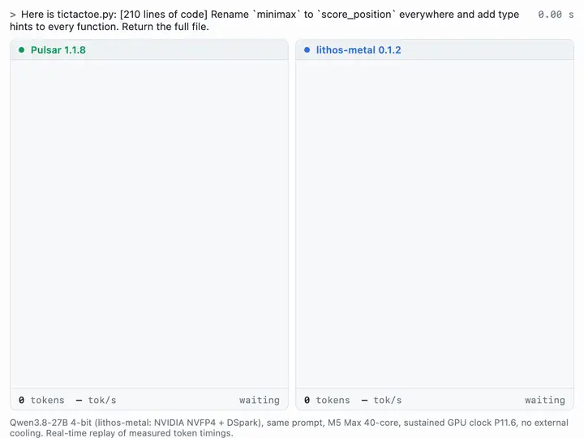
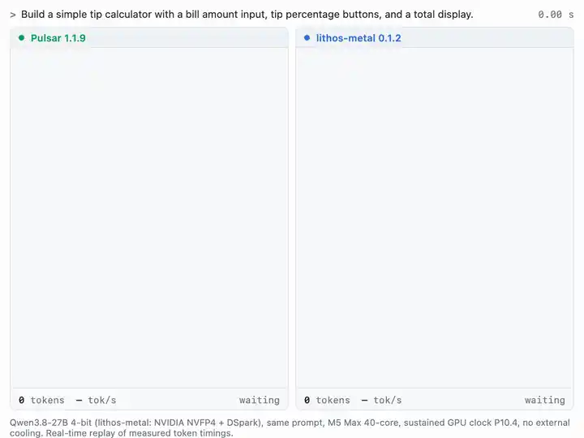
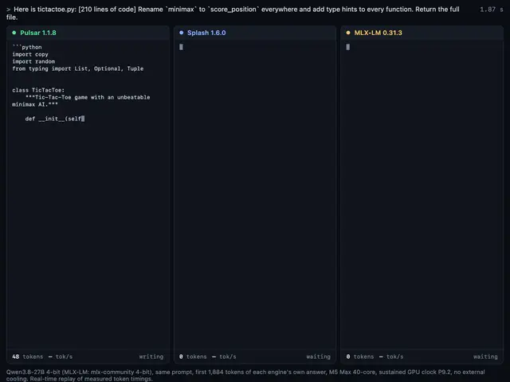
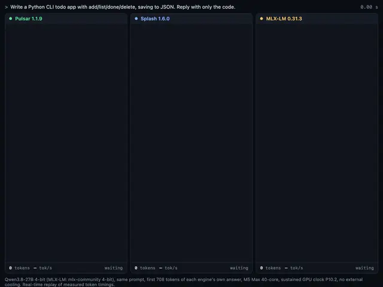
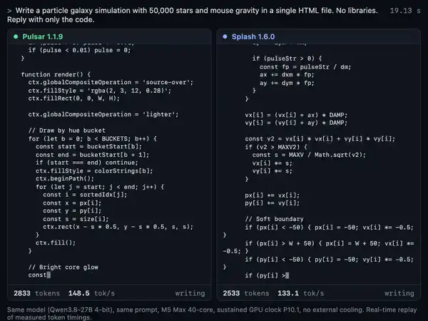
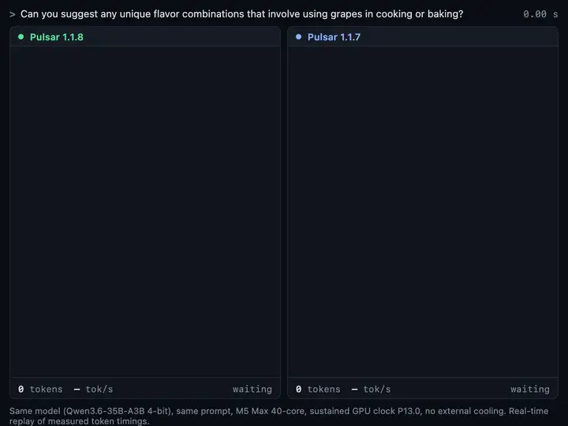

<!-- Modified by Pulsar. (Splash's original README is docs/SPLASH-README.md.) -->
<h1 align="center">Pulsar</h1>

<p align="center">Run Qwen3.8-27B and Qwen3.6-35B-A3B fast on your Mac.<br>
A fork of Inco AI's <a href="https://github.com/incoai/splash">Splash</a>, with faster GPU kernels and smarter drafting.</p>

<p align="center">
<a href="https://github.com/loopai-hq/pulsar/releases/latest"></a>
<a href="LICENSE"></a>


</p>

<p align="center"><a href="docs/media/lithos-edit.mp4"></a><br>
<sub>Editing a pasted 210-line file: Pulsar 1.1.8 8.6 s, lithos-metal 0.1.2 16.4 s (first 1,884 tokens, 307 vs 150 tok/s).
<a href="docs/media/lithos-edit.mp4">Video</a> · <a href="#videos">More videos</a></sub></p>

On an M5 Max with Qwen3.8-27B:

- **347 tok/s** editing a pasted file, peaking at 477
- **156 tok/s** writing a small app from scratch
- **1.42×** lithos-metal 0.1.2 and **1.13×** Splash 1.3.0
- **0.1 s** to start a prompt it has seen before

Every token is still checked by the full model, so you get the model's own answers, just sooner.

## Quick start

Download `pulsar-1.1.8-macos-arm64.tar.gz` from [Releases](https://github.com/loopai-hq/pulsar/releases/latest), then:

```bash
tar -xzf pulsar-1.1.8-macos-arm64.tar.gz && cd pulsar
SPLASH_DRAFT_HEAD_IDS=$PWD/data/head-ranked.u32 ./pulsar serve --model incoai/Qwen3.8-27B-Splash
```

Open <http://127.0.0.1:8000> to chat. The first run downloads the model (17.4 GB) and spends about 20 seconds
setting up Python. The server speaks the OpenAI and Anthropic APIs, so most apps can use it as is.

- **Qwen3.6-35B-A3B:** `./pulsar serve --model incoai/Qwen3.6-35B-A3B-Splash`
- **24 GB Mac:** run `sudo sysctl iogpu.wired_limit_mb=20480` once (it lasts until a restart), and put
  `SPLASH_TEXT_ONLY=1` in front of the serve command.
- **Downloaded with a browser or AirDrop:** run `/usr/bin/xattr -dr com.apple.quarantine .` in the `pulsar` folder first.

### Use it with a coding agent

Leave the server running, open a second terminal in the `pulsar` folder and run:

```bash
./pulsar opencode    # or: ./pulsar claude / ./pulsar codex / ./pulsar hermes
```

The agent opens already connected. Other apps can use `http://127.0.0.1:8000/v1` (OpenAI) or
`http://127.0.0.1:8000` (Anthropic) with the model `incoai/Qwen3.8-27B-Splash`.

There's also a skill that teaches an agent to install, start and stop Pulsar:
[`.claude/skills/pulsar`](.claude/skills/pulsar/SKILL.md). Claude Code and OpenCode pick it up in this folder; copy it to
`~/.claude/skills/` (or `~/.agents/skills/` for Codex) to use it anywhere.

## How fast

Qwen3.8-27B 4-bit on an M5 Max (40-core GPU, 128 GB). Each pair ran in one session, taking turns on the same prompts.

| Engine | Drafts with | Its tok/s | Pulsar's tok/s | Pulsar is |
|---|---|---:|---:|---:|
| lithos-metal 0.1.2 | DSpark draft head | 81.6 | 115.2 | **1.42×** |
| Splash 1.3.0 | DFlash 2 draft model | 86.5 | 98.6 | **1.13×** |
| MTPLX | the model's own MTP | 64.9 | 125.0 | **1.93×** |
| AX Engine | the model's own MTP | 38.3 | 123.2 | **3.22×** |
| MLX-LM | nothing (its default) | 31.4 | 129.5 | **4.12×** |
| llama.cpp | nothing (its default) | 27.5 | 122.3 | **4.45×** |

Pulsar 1.1.7 (2026-10-14); the Splash and MTPLX rows are Pulsar 1.1.5 (2026-10-10). Each engine ran its own prompt set,
so compare within a row. lithos-metal runs NVIDIA's checkpoint, which keeps attention in FP8 and reads 17.6 GB of
weights per step against Pulsar's 14.4 GB.

On Qwen3.6-35B-A3B, a mixture-of-experts model that only uses a few small blocks per token, Pulsar 1.1.8 writes
**331.5 tok/s** on average across 12 prompts (greedy, 2026-11-06).

Every session, prompt and setting: [docs/BENCHMARKS.md](docs/BENCHMARKS.md).

## What's new in 1.1.8

Qwen3.6-35B-A3B is faster, especially with several requests at once, and answers start sooner on both models. Answers
match 1.1.7. Measured against 1.1.7 on the same M5 Max, taking turns on the same prompts (2026-11-06):

| | 1.1.7 | 1.1.8 | |
|---|---:|---:|---|
| Qwen3.6-35B-A3B, greedy | 310.9 tok/s | 331.5 tok/s | **7.7% faster** |
| Qwen3.6-35B-A3B, sampled | 269.7 tok/s | 277.0 tok/s | **2.6% faster** |
| Qwen3.6-35B-A3B, 2 requests at once | 347.1 tok/s | 391.1 tok/s | **12.7% faster** |
| Qwen3.6-35B-A3B, 4 requests at once | 496.3 tok/s | 543.8 tok/s | **9.6% faster** |
| Qwen3.8-27B, first token | 227 ms | 187 ms | **40 ms sooner** |
| Qwen3.6-35B-A3B, first token | 75.8 ms | 62.6 ms | **13 ms sooner** |

Qwen3.8-27B writes at 1.1.7's speed. 1.1.8 also brings fixes from Splash 1.3.1 to 1.6.0: invalid numbers are never
cached, a restart after a crash serves requests again, and the launcher keeps the server's key away from any proxy.
Older releases: [Releases](https://github.com/loopai-hq/pulsar/releases).

## How it works

A model writes one token (a word or part of one) at a time. Pulsar pairs it with a small draft model that guesses the
next few tokens; the full model checks all the guesses in one step and keeps the ones it agrees with. On top of
Splash, Pulsar adds:

- **Guesses from your prompt.** When an answer repeats your input, like an edit to a pasted file, Pulsar takes its
  guesses straight from the prompt, so the model can keep many tokens per step.
- **A lighter draft model.** It picks from a shorter list of the tokens the model writes most
  (`data/head-ranked.u32`), so each guess costs less.
- **Faster GPU kernels**, tuned by measurement on an M5 Max.
- **Text-only mode.** `SPLASH_TEXT_ONLY=1` skips the image weights to leave more memory for context on smaller Macs.

What each part does and what it gained: [docs/WHATS-INSIDE.md](docs/WHATS-INSIDE.md). Every change has a switch:
[docs/SWITCHES.md](docs/SWITCHES.md).

## Videos

Real-time replays of measured token timings, Pulsar 1.1.8 on an M5 Max (40-core GPU) with no extra cooling, greedy,
recorded 2026-11-08. Engines in a video ran in the same session; where answers differ in length, the race covers the
first N tokens of each engine's own answer.

<p align="center"><a href="docs/media/lithos-tip.mp4"></a><br>
<sub>lithos-metal's own launch-video prompt: Pulsar 1.1.8 writes 3,000 tokens in 22.3 s (135 tok/s), lithos-metal 0.1.2
in 25.3 s (120 tok/s). <a href="docs/media/lithos-tip.mp4">Video</a></sub></p>

<p align="center"><a href="docs/media/code-edit.mp4"></a><br>
<sub>Editing a pasted file: Pulsar 1.1.8 7.2 s · Splash 1.6.0 11.8 s · MLX-LM 67.7 s (first 1,884 tokens; 336 vs 191 vs
29 tok/s). <a href="docs/media/code-edit.mp4">Video</a></sub></p>

<p align="center"><a href="docs/media/speed-race.mp4"></a><br>
<sub>A small Python app: Pulsar 1.1.8 3.92 s · Splash 1.6.0 4.31 s · MLX-LM 23.6 s (first 708 tokens; 185 vs 167 vs
30 tok/s). <a href="docs/media/speed-race.mp4">Video</a></sub></p>

<p align="center"><a href="docs/media/galaxy-app.mp4"></a><br>
<sub>A particle-galaxy app in one shot: Pulsar 1.1.8 20.0 s, Splash 1.6.0 23.1 s (first 3,124 tokens), then the app runs.
<a href="docs/media/galaxy-app.mp4">Video</a></sub></p>

<p align="center"><a href="docs/media/moe-chat.mp4"></a><br>
<sub>Qwen3.6-35B-A3B, 1.1.8 vs 1.1.7: the same 1,024-token answer at 271 vs 247 tok/s (3.80 s vs 4.20 s).
<a href="docs/media/moe-chat.mp4">Video</a></sub></p>

## Requirements

| | |
|---|---|
| Mac | Apple silicon, M3 or newer (tested on M5 Max and M5 Pro) |
| macOS | 26.4 or later |
| Memory | 24 GB or more for Qwen3.8-27B |
| Disk | 17.4 GB for Qwen3.8-27B, 20.9 GB for Qwen3.6-35B-A3B |
| Python | 3.12 to 3.14 |

## Build from source

This repository holds the Apache-2.0 source of Pulsar 1.1.4. Building it needs the full Xcode app; the download
above doesn't.

```bash
git clone https://github.com/loopai-hq/pulsar && cd pulsar
make install MODEL=incoai/Qwen3.8-27B-Splash
SPLASH_DRAFT_HEAD_IDS=$PWD/data/head-ranked.u32 ./pulsar serve --model incoai/Qwen3.8-27B-Splash
```

## Models

- [loopai-hq/Qwen3.8-27B-Pulsar](https://huggingface.co/loopai-hq/Qwen3.8-27B-Pulsar)
- [loopai-hq/Qwen3.6-35B-A3B-Pulsar](https://huggingface.co/loopai-hq/Qwen3.6-35B-A3B-Pulsar)

They carry Inco AI's Splash model packages unchanged, with full credit, plus Pulsar's draft token list for Qwen3.8-27B.

## Credits and license

Apache License 2.0 ([LICENSE](LICENSE), [NOTICE](NOTICE)). The download includes LICENSE, NOTICE and
THIRD_PARTY_NOTICES. If you build on Pulsar, keep the NOTICE file and credit Pulsar. Pulsar was called fastkernel until
version 1.1.3.

Thank you to [Inco AI](https://github.com/incoai) for [Splash](https://github.com/incoai/splash), the engine Pulsar is
built on (1.1.8 is built on Splash 1.3.0), and for the DFlash 2 draft models and model packages Pulsar runs; to the
Qwen team for the models; and to mlx-community for the 4-bit conversions. Splash's own README is
[docs/SPLASH-README.md](docs/SPLASH-README.md). Third-party code keeps its own license
([THIRD_PARTY_NOTICES](THIRD_PARTY_NOTICES)). Files changed from Splash say "Modified by Pulsar."; the full list is in
[docs/CHANGED-FILES.md](docs/CHANGED-FILES.md).
