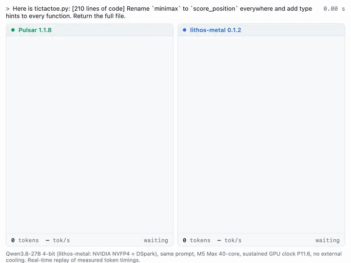
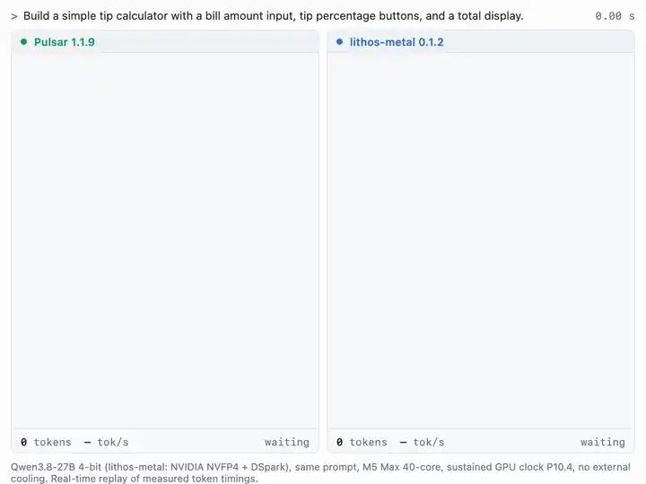
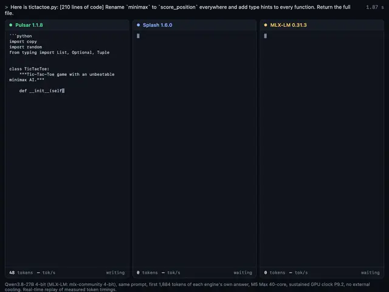
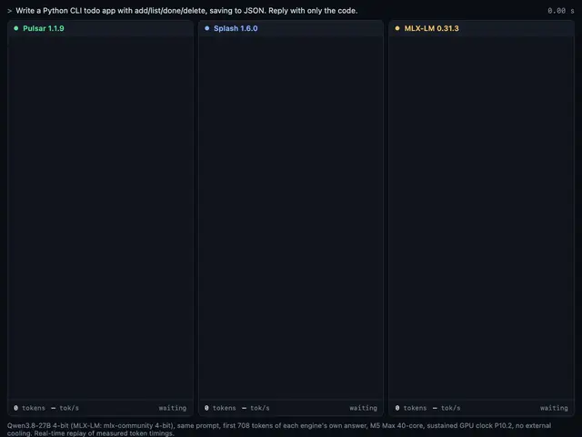
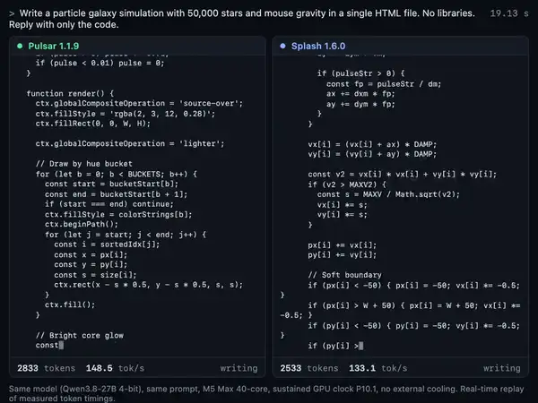
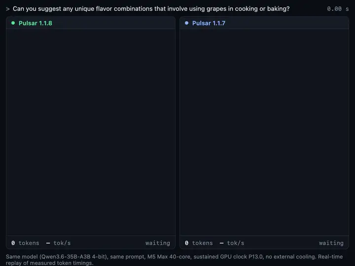

<!-- Modified by Pulsar. (Splash's original README is docs/SPLASH-README.md.) -->
<h1 align="center">Pulsar</h1>

<p align="center">The fastest inference engine for Qwen3.8-27B, Qwen3.6-35B-A3B and Inkling 2 Mini on Apple Silicon.<br>
A fork of Inco AI's <a href="https://github.com/incoai/splash">Splash</a>, with faster GPU kernels and smarter drafting.</p>

<p align="center">
<a href="https://github.com/loopai-hq/pulsar/releases/latest"></a>
<a href="LICENSE"></a>


</p>

<p align="center"><a href="docs/media/lithos-edit.mp4"></a><br>
<sub>Editing a pasted 210-line file: Pulsar 1.1.9 7.2 s, lithos-metal 0.1.2 18.7 s (first 1,884 tokens, 340 vs 132 tok/s).
<a href="docs/media/lithos-edit.mp4">Video</a> · <a href="#videos">More videos</a></sub></p>

- **347 tok/s** editing a pasted file with Qwen3.8-27B, peaking at 477
- **326 tok/s** on Qwen3.6-35B-A3B
- **1.42×** lithos-metal and **1.13×** Splash on Qwen3.8-27B
- **1.27×** MTPLX writing code with Inkling 2 Mini

Every token is checked by the full model, so you get the model's own answers, just sooner.

## Quick start

Download `pulsar-1.2.1-macos-arm64.tar.gz` from [Releases](https://github.com/loopai-hq/pulsar/releases/latest), then:

```bash
tar -xzf pulsar-1.2.1-macos-arm64.tar.gz && cd pulsar
./pulsar serve --model mlx-community/Qwen3.8-27B-4bit
```

Open <http://127.0.0.1:8000> to chat. The server speaks the OpenAI and Anthropic APIs, so most apps can use it as is.

| Model | Command | Disk |
|---|---|---|
| Qwen3.8-27B | `./pulsar serve --model mlx-community/Qwen3.8-27B-4bit` | 17.4 GB |
| Qwen3.6-35B-A3B | `./pulsar serve --model mlx-community/Qwen3.6-35B-A3B-4bit` | 20.9 GB |
| Inkling 2 Mini | `./pulsar serve --model mlx-community/Inkling-2-Mini-4bit` | 17.3 GB + 0.6 GB draft |

The first run downloads the model and spends about 20 seconds setting up Python. A model's first start also prepares
Pulsar's GPU kernels for your Mac, once (about a minute for Inkling 2 Mini, 2 to 3 minutes for the Qwen models);
later starts are ready in seconds.

- **Inkling 2 Mini** also fetches its draft, `mtp.safetensors` from
  [thinkingmachines/Inkling-2-Mini](https://huggingface.co/thinkingmachines/Inkling-2-Mini), and serves the model's
  text.
- **24 GB Mac:** run `sudo sysctl iogpu.wired_limit_mb=20480` once (it lasts until a restart), and put
  `SPLASH_TEXT_ONLY=1` in front of the serve command.
- **Downloaded with a browser or AirDrop:** run `/usr/bin/xattr -dr com.apple.quarantine .` in the `pulsar` folder first.

### Use it with a coding agent

Leave the server running, open a second terminal in the `pulsar` folder and run:

```bash
./pulsar opencode    # or: ./pulsar claude / ./pulsar codex / ./pulsar hermes
```

The agent opens already connected. Other apps can use `http://127.0.0.1:8000/v1` (OpenAI) or
`http://127.0.0.1:8000` (Anthropic) with the model name you served.

An agent skill that installs, starts and stops Pulsar is in [`.claude/skills/pulsar`](.claude/skills/pulsar/SKILL.md).
Claude Code and OpenCode pick it up in this folder; copy it to `~/.claude/skills/` (or `~/.agents/skills/` for Codex)
to use it anywhere.

## Performance

M5 Max (40-core GPU, 128 GB). Each pair ran in one session, taking turns on the same prompts.

| Model | Engine | Its tok/s | Pulsar's tok/s | Pulsar is |
|---|---|---:|---:|---:|
| Qwen3.8-27B | lithos-metal 0.1.2 | 81.6 | 115.2 | **1.42×** |
| Qwen3.8-27B | Splash 1.3.0 | 86.5 | 98.6 | **1.13×** |
| Qwen3.8-27B | MTPLX | 64.9 | 125.0 | **1.93×** |
| Qwen3.8-27B | AX Engine | 38.3 | 123.2 | **3.22×** |
| Qwen3.8-27B | MLX-LM | 31.4 | 129.5 | **4.12×** |
| Qwen3.8-27B | llama.cpp | 27.5 | 122.3 | **4.45×** |
| Inkling 2 Mini, code | MTPLX 2.13.1 | 81.9 | 104.3 | **1.27×** |

Qwen3.8-27B rows: Pulsar 1.1.7 (2026-10-14); the Splash and MTPLX rows Pulsar 1.1.5 (2026-10-10). Inkling 2 Mini:
Pulsar 1.2.0 (2026-11-24). Each engine ran its own prompt set, so compare within a row. On Qwen3.6-35B-A3B, Pulsar
writes 326 tok/s on average across 12 prompts (1.1.9, greedy, 2026-11-10). Pulsar 1.2.1 chats on Inkling 2 Mini
1.056× as fast as 1.2.0 (87.7 against 82.3 tok/s, 2026-11-24).

Every session, prompt and setting: [docs/BENCHMARKS.md](docs/BENCHMARKS.md). What changed in each version:
[Releases](https://github.com/loopai-hq/pulsar/releases).

## How it works

A model writes one token (a word or part of one) at a time. Pulsar pairs it with a small draft model that guesses the
next few tokens; the full model checks all the guesses in one step and keeps the ones it agrees with. On top of
Splash, Pulsar adds:

- **Guesses from your prompt.** When an answer repeats your input, like an edit to a pasted file, Pulsar takes its
  guesses straight from the prompt and keeps many tokens per step.
- **A lighter draft model.** It picks from a shorter list of the tokens the model writes most
  (`data/head-ranked.u32`), so each guess costs less.
- **Faster GPU kernels**, tuned by measurement on an M5 Max.
- **Text-only mode.** `SPLASH_TEXT_ONLY=1` skips the image weights to leave more memory for context on smaller Macs.

What each part does: [docs/WHATS-INSIDE.md](docs/WHATS-INSIDE.md). Every setting: [docs/SWITCHES.md](docs/SWITCHES.md).

## Videos

Real-time replays of measured token timings: Pulsar 1.1.9 on an M5 Max (40-core GPU), greedy, 2026-11-10. Engines in
a video ran in the same session.

<p align="center"><a href="docs/media/lithos-tip.mp4"></a><br>
<sub>lithos-metal's own launch-video prompt: Pulsar writes 3,000 tokens in 19.9 s (151 tok/s), lithos-metal 0.1.2 in
25.1 s (120 tok/s). <a href="docs/media/lithos-tip.mp4">Video</a></sub></p>

<p align="center"><a href="docs/media/code-edit.mp4"></a><br>
<sub>Editing a pasted file: Pulsar 7.0 s · Splash 1.6.0 11.7 s · MLX-LM 67.2 s (first 1,884 tokens; 351 vs 194 vs
29 tok/s). <a href="docs/media/code-edit.mp4">Video</a></sub></p>

<p align="center"><a href="docs/media/speed-race.mp4"></a><br>
<sub>A small Python app: Pulsar 3.84 s · Splash 1.6.0 4.22 s · MLX-LM 24.5 s (first 708 tokens; 188 vs 171 vs
29 tok/s). <a href="docs/media/speed-race.mp4">Video</a></sub></p>

<p align="center"><a href="docs/media/galaxy-app.mp4"></a><br>
<sub>A particle-galaxy app in one shot: Pulsar 24.7 s, Splash 1.6.0 27.3 s (the same 3,759-token answer), then the app
runs. <a href="docs/media/galaxy-app.mp4">Video</a></sub></p>

<p align="center"><a href="docs/media/moe-chat.mp4"></a><br>
<sub>Qwen3.6-35B-A3B, Pulsar 1.1.9 vs 1.1.8: 1,024 tokens at 284 vs 273 tok/s (3.62 s vs 3.78 s).
<a href="docs/media/moe-chat.mp4">Video</a></sub></p>

## Requirements

| | |
|---|---|
| Mac | Apple silicon, M3 or newer (tested on M5 Max and M5 Pro) |
| macOS | 26.4 or later |
| Memory | 24 GB or more for Qwen3.8-27B |
| Python | 3.12 to 3.14 |

## Build from source

This repository holds the Apache-2.0 source of Pulsar 1.1.4. Building it needs the full Xcode app; the download
above doesn't.

```bash
git clone https://github.com/loopai-hq/pulsar && cd pulsar
make install MODEL=incoai/Qwen3.8-27B-Splash
SPLASH_DRAFT_HEAD_IDS=$PWD/data/head-ranked.u32 ./pulsar serve --model incoai/Qwen3.8-27B-Splash
```

## Models

- [loopai-hq/Qwen3.8-27B-Pulsar](https://huggingface.co/loopai-hq/Qwen3.8-27B-Pulsar)
- [loopai-hq/Qwen3.6-35B-A3B-Pulsar](https://huggingface.co/loopai-hq/Qwen3.6-35B-A3B-Pulsar)
- Inkling 2 Mini: [mlx-community/Inkling-2-Mini-4bit](https://huggingface.co/mlx-community/Inkling-2-Mini-4bit) with
  the draft from [thinkingmachines/Inkling-2-Mini](https://huggingface.co/thinkingmachines/Inkling-2-Mini)

The Qwen packages carry Inco AI's Splash model packages unchanged, with full credit, plus Pulsar's draft token list
for Qwen3.8-27B.

## Credits and license

Apache License 2.0 ([LICENSE](LICENSE), [NOTICE](NOTICE)). The download includes LICENSE, NOTICE and
THIRD_PARTY_NOTICES. If you build on Pulsar, keep the NOTICE file and credit Pulsar. Pulsar was called fastkernel until
version 1.1.3.

Thank you to [Inco AI](https://github.com/incoai) for [Splash](https://github.com/incoai/splash), the engine Pulsar is
built on, and for the DFlash 2 draft models and model packages Pulsar runs; to the Qwen team for the Qwen models; to
[thinkingmachines](https://huggingface.co/thinkingmachines) for Inkling 2 Mini and its draft; and to mlx-community for
the 4-bit conversions. Splash's own README is [docs/SPLASH-README.md](docs/SPLASH-README.md). Third-party code keeps
its own license ([THIRD_PARTY_NOTICES](THIRD_PARTY_NOTICES)). Files changed from Splash say "Modified by Pulsar."; the
full list is in [docs/CHANGED-FILES.md](docs/CHANGED-FILES.md).
